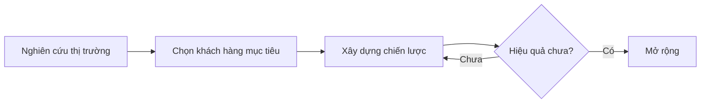
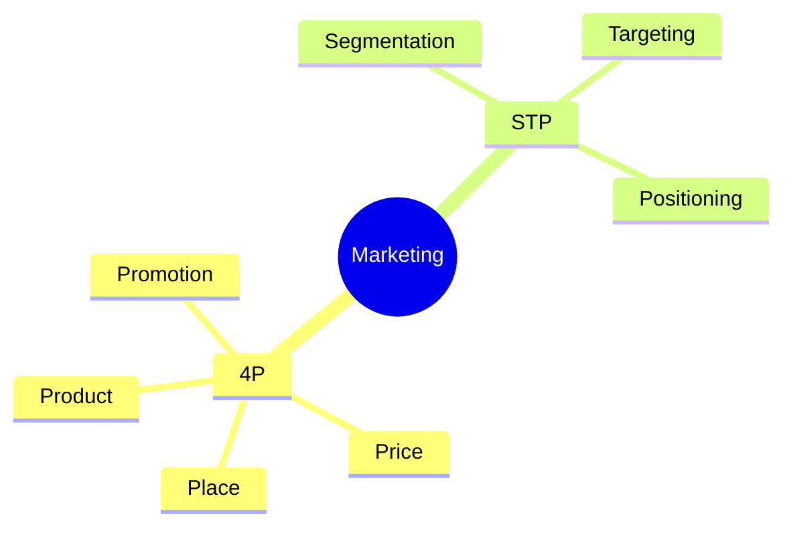
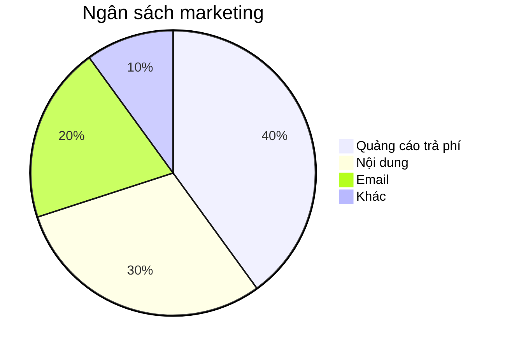
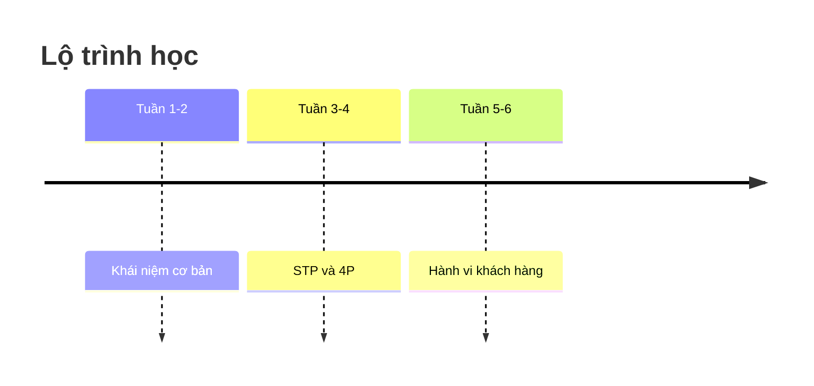
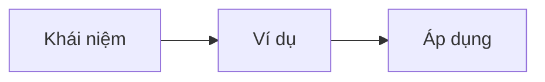

# 📘 Bảng tra cứu Markdown cho GitHub

> File này vừa là hướng dẫn, vừa là ví dụ. Mở tab **Preview** để xem kết quả, mở **Edit** hoặc **Raw** để xem cách gõ.

## 📑 Mục lục
1. [Tiêu đề](#1-tiêu-đề)
2. [Định dạng chữ](#2-định-dạng-chữ)
3. [Danh sách](#3-danh-sách)
4. [Link và hình ảnh](#4-link-và-hình-ảnh)
5. [Bảng](#5-bảng)
6. [Code](#6-code)
7. [Trích dẫn và hộp cảnh báo](#7-trích-dẫn-và-hộp-cảnh-báo)
8. [Đường kẻ, xuống dòng, ký tự đặc biệt](#8-đường-kẻ-xuống-dòng-ký-tự-đặc-biệt)
9. [Phần thu gọn](#9-phần-thu-gọn)
10. [Sơ đồ Mermaid](#10-sơ-đồ-mermaid)
11. [Emoji](#11-emoji)
12. [Công thức toán](#12-công-thức-toán)
13. [Chú thích cuối trang](#13-chú-thích-cuối-trang)
14. [Một số thẻ HTML dùng được](#14-một-số-thẻ-html-dùng-được)
15. [Huy hiệu (badge)](#15-huy-hiệu-badge)
16. [Mẫu trang ghi chú học tập](#16-mẫu-trang-ghi-chú-học-tập)

---

## 1. Tiêu đề

Dùng dấu `#`, càng nhiều dấu thì tiêu đề càng nhỏ. Phải có **khoảng trắng** sau dấu `#`.

```
# Tiêu đề cấp 1
## Tiêu đề cấp 2
### Tiêu đề cấp 3
#### Tiêu đề cấp 4
##### Tiêu đề cấp 5
###### Tiêu đề cấp 6
```

GitHub tự tạo **mục lục** từ các tiêu đề: bấm biểu tượng danh sách ở góc trên bên phải khi xem file.

---

## 2. Định dạng chữ

| Muốn có | Gõ | Kết quả |
|---|---|---|
| In nghiêng | `*nghiêng*` hoặc `_nghiêng_` | *nghiêng* |
| In đậm | `**đậm**` | **đậm** |
| Vừa đậm vừa nghiêng | `***đậm nghiêng***` | ***đậm nghiêng*** |
| Gạch ngang | `~~gạch ngang~~` | ~~gạch ngang~~ |
| Chỉ số trên | `x<sup>2</sup>` | x<sup>2</sup> |
| Chỉ số dưới | `H<sub>2</sub>O` | H<sub>2</sub>O |
| Phím bấm | `<kbd>Ctrl</kbd> + <kbd>C</kbd>` | <kbd>Ctrl</kbd> + <kbd>C</kbd> |
| Làm nổi bật | `<mark>nổi bật</mark>` | <mark>nổi bật</mark> |

Chữ trong ô code nhỏ: đặt giữa hai dấu huyền, ví dụ `` `code` ``.

---

## 3. Danh sách

**Danh sách gạch đầu dòng** (dùng `-`, `*` hoặc `+`):

```
- Mục 1
- Mục 2
  - Mục con (thụt vào 2 khoảng trắng)
    - Mục cháu
```

- Mục 1
- Mục 2
  - Mục con
    - Mục cháu

**Danh sách đánh số:**

```
1. Bước một
2. Bước hai
   1. Bước hai-một
3. Bước ba
```

1. Bước một
2. Bước hai
   1. Bước hai-một
3. Bước ba

**Danh sách việc cần làm (có ô tick bấm được trong Issue, chỉ hiển thị trong file):**

```
- [x] Đã xong
- [ ] Chưa xong
```

- [x] Đã xong
- [ ] Chưa xong

---

## 4. Link và hình ảnh

**Link:**

```
[Chữ hiển thị](https://github.com)
[Link kèm gợi ý](https://github.com "Trang chủ GitHub")
<https://github.com>
```

[Chữ hiển thị](https://github.com) · <https://github.com>

**Link tới file khác trong cùng repo** (đường dẫn tương đối):

```
[Xem ghi chú STP](co-ban/stp.md)
[Về mục lục](README.md)
```

**Link nhảy tới tiêu đề trong cùng file** (viết thường, thay khoảng trắng bằng `-`):

```
[Đi tới phần Bảng](#5-bảng)
```

**Hình ảnh** giống link nhưng thêm dấu `!` phía trước:

```


```

Cách dễ nhất để thêm ảnh: đang sửa file trên GitHub, **kéo thả ảnh vào khung soạn thảo**, GitHub sẽ tự tải lên và chèn sẵn dòng cú pháp.

**Chỉnh kích thước ảnh** (dùng HTML):

```

```

**Ảnh có thể bấm vào để mở link:**

```
[](https://github.com)
```

**Tự động nhận diện trên GitHub:**

| Gõ | Tác dụng |
|---|---|
| `@tên-người-dùng` | Nhắc tới một tài khoản |
| `#12` | Link tới Issue hoặc Pull Request số 12 |
| Dán một link trần | Tự thành link bấm được |

---

## 5. Bảng

```
| Cột 1 | Cột 2 | Cột 3 |
|:---|:---:|---:|
| Canh trái | Canh giữa | Canh phải |
| A | B | C |
```

| Cột 1 | Cột 2 | Cột 3 |
|:---|:---:|---:|
| Canh trái | Canh giữa | Canh phải |
| A | B | C |

**Quy tắc cần nhớ:**
- Dòng `---` ngay dưới tiêu đề là **bắt buộc**.
- `:---` canh trái, `:---:` canh giữa, `---:` canh phải.
- Muốn xuống dòng trong một ô: dùng `<br>`.
- Muốn có dấu `|` trong ô: viết `\|`.
- Trong ô vẫn dùng được **đậm**, *nghiêng*, link, emoji.

---

## 6. Code

**Code trong dòng:** đặt giữa hai dấu huyền `` ` ``.

**Khối code:** dùng ba dấu huyền, ghi tên ngôn ngữ ngay sau để có màu chữ.

````
```python
print("Xin chào")
```
````

```python
print("Xin chào")
```

Một số tên ngôn ngữ thường dùng: `python`, `javascript`, `html`, `css`, `json`, `bash`, `sql`, `markdown`, `text` (không tô màu).

**Hiển thị nguyên cú pháp Markdown** (như file này đang làm): dùng **bốn** dấu huyền ở ngoài để bao ba dấu huyền ở trong.

**Khối code khác (hiển thị thay đổi, màu xanh/đỏ):**

````
```diff
+ dòng được thêm
- dòng bị xóa
```
````

```diff
+ dòng được thêm
- dòng bị xóa
```

---

## 7. Trích dẫn và hộp cảnh báo

**Trích dẫn:**

```
> Đây là một đoạn trích dẫn.
>
> > Trích dẫn lồng bên trong.
```

> Đây là một đoạn trích dẫn.
>
> > Trích dẫn lồng bên trong.

**Hộp cảnh báo của GitHub** (có màu và biểu tượng riêng):

```
> [!NOTE]
> Thông tin bổ sung hữu ích.

> [!TIP]
> Mẹo giúp làm tốt hơn.

> [!IMPORTANT]
> Điều quan trọng cần biết.

> [!WARNING]
> Cần chú ý, có thể gây vấn đề.

> [!CAUTION]
> Nguy hiểm, có thể gây hậu quả nghiêm trọng.
```

> [!NOTE]
> Thông tin bổ sung hữu ích.

> [!TIP]
> Mẹo giúp làm tốt hơn.

> [!IMPORTANT]
> Điều quan trọng cần biết.

> [!WARNING]
> Cần chú ý, có thể gây vấn đề.

> [!CAUTION]
> Nguy hiểm, có thể gây hậu quả nghiêm trọng.

---

## 8. Đường kẻ, xuống dòng, ký tự đặc biệt

**Đường kẻ ngang:** gõ `---` (hoặc `***`) trên một dòng riêng, có dòng trống phía trên.

---

**Xuống dòng:**
- Muốn sang **đoạn mới**: để một dòng trống.
- Muốn xuống dòng **trong cùng đoạn**: gõ hai khoảng trắng ở cuối dòng, hoặc dùng `<br>`.

**Hiển thị ký tự đặc biệt** (đặt dấu `\` phía trước để Markdown không hiểu nhầm):

```
\*không nghiêng\*   \# không phải tiêu đề   \| dấu gạch đứng
```

Các ký tự thường cần escape: `\` `` ` `` `*` `_` `{ }` `[ ]` `( )` `#` `+` `-` `.` `!` `|`

**Dòng chú thích ẩn** (không hiện ra khi xem):

```
<!-- Đây là ghi chú cho riêng tôi, người đọc không thấy -->
```

<!-- Đây là ghi chú cho riêng tôi, người đọc không thấy -->

---

## 9. Phần thu gọn

Rất hợp để giấu đáp án, phần dài hoặc ghi chú phụ.

```
<details>
<summary>Bấm để mở</summary>

Nội dung bên trong, vẫn dùng được **Markdown**.

- Gạch đầu dòng
- Hay bảng, code...

</details>
```

<details>
<summary>Bấm để mở</summary>

Nội dung bên trong, vẫn dùng được **Markdown**.

- Gạch đầu dòng
- Hay bảng, code...

</details>

> [!NOTE]
> Phải có **dòng trống** ngay sau thẻ `</summary>` và trước thẻ `</details>`, nếu không phần Markdown bên trong sẽ không hiển thị đúng.

---

## 10. Sơ đồ Mermaid

GitHub tự vẽ sơ đồ từ khối code có tên ngôn ngữ `mermaid`.

**Sơ đồ luồng** (`LR` là trái sang phải, `TD` là trên xuống dưới):

````

````


**Hình dạng ô:**

| Gõ | Hình |
|---|---|
| `A[Chữ]` | Hình chữ nhật |
| `A(Chữ)` | Chữ nhật bo góc |
| `A([Chữ])` | Hình viên thuốc |
| `A{Chữ}` | Hình thoi (câu hỏi, quyết định) |
| `A((Chữ))` | Hình tròn |

**Sơ đồ tư duy (mindmap):**

````

````


**Biểu đồ tròn:**

````

````


**Lịch trình (timeline):**

````

````


---

## 11. Emoji

Gõ trực tiếp emoji (Windows: <kbd>Win</kbd> + <kbd>.</kbd>) hoặc dùng mã dạng `:tên:`.

| Gõ | Ra | Gõ | Ra |
|---|---|---|---|
| `:dart:` | :dart: | `:bulb:` | :bulb: |
| `:books:` | :books: | `:memo:` | :memo: |
| `:white_check_mark:` | :white_check_mark: | `:warning:` | :warning: |
| `:rocket:` | :rocket: | `:chart_with_upwards_trend:` | :chart_with_upwards_trend: |
| `:star:` | :star: | `:pushpin:` | :pushpin: |
| `:fire:` | :fire: | `:question:` | :question: |

Gợi ý dùng: 🎯 mục tiêu · 📌 điểm chính · 💡 ý tưởng · ✅ đã xong · ⚠️ lưu ý · 📚 tài liệu · 📝 ghi chú · 🔍 tìm hiểu thêm

---

## 12. Công thức toán

Đặt công thức giữa dấu `$` (trong dòng) hoặc `$$` (riêng một dòng):

```
Tỷ lệ chuyển đổi: $CR = \frac{\text{số đơn}}{\text{số lượt truy cập}} \times 100$

$$
ROI = \frac{\text{Lợi nhuận} - \text{Chi phí}}{\text{Chi phí}} \times 100\%
$$
```

Tỷ lệ chuyển đổi: $CR = \frac{\text{số đơn}}{\text{số lượt truy cập}} \times 100$

$$
ROI = \frac{\text{Lợi nhuận} - \text{Chi phí}}{\text{Chi phí}} \times 100\%
$$

---

## 13. Chú thích cuối trang

```
Đây là câu cần chú thích[^1].

[^1]: Nội dung chú thích hiện ở cuối trang.
```

Đây là câu cần chú thích[^1].

[^1]: Nội dung chú thích hiện ở cuối trang.

---

## 14. Một số thẻ HTML dùng được

| Thẻ | Tác dụng |
|---|---|
| `<br>` | Xuống dòng |
| `<details>`, `<summary>` | Phần thu gọn |
| `<kbd>` | Phím bấm |
| `<sup>`, `<sub>` | Chỉ số trên, dưới |
| `<mark>` | Tô nổi bật |
| `` | Ảnh có chỉnh kích thước |
| `<div align="center">` | Canh giữa nội dung |
| `<ins>`, `<del>` | Gạch dưới, gạch ngang |

**Canh giữa tiêu đề hoặc ảnh:**

```
<div align="center">

# Tiêu đề ở giữa

Dòng mô tả ở giữa

</div>
```

> [!NOTE]
> GitHub chặn một số thẻ HTML vì lý do bảo mật (như `<script>`, `<style>`), và không hỗ trợ đổi màu chữ bằng HTML. Muốn có màu sắc, hãy dùng emoji, hộp cảnh báo hoặc sơ đồ Mermaid.

---

## 15. Huy hiệu (badge)

Huy hiệu là ảnh nhỏ tạo từ dịch vụ shields.io, đặt ở đầu README cho đẹp:

```


```


Cấu trúc: `badge/Nhãn-Giá trị-Màu`. Khoảng trắng viết thành `%20`. Một số màu: `blue`, `green`, `orange`, `red`, `yellow`, `lightgrey`, `purple`.

---

## 16. Mẫu trang ghi chú học tập

Copy khung dưới đây cho mỗi chủ đề mới:

````
# 🎯 Tên chủ đề


> 📅 Ngày học: 16/10/2026

## 🧭 Tổng quan


## 📌 Nội dung chính
- **Ý 1:** giải thích bằng lời của bạn
- **Ý 2:** ...

## 📊 So sánh
| Tiêu chí | A | B |
|---|---|---|
| ... | ... | ... |

## 🧪 Ví dụ thực tế
Phân tích một thương hiệu quen thuộc.

> [!TIP]
> Điều tôi thấy hay nhất:

## ❓ Còn thắc mắc
- [ ] Câu hỏi 1
- [ ] Câu hỏi 2

<details>
<summary>📚 Tài liệu tham khảo</summary>

- Tên sách, khóa học, link

</details>

## ✅ Tự kiểm tra
- [ ] Tôi giải thích được chủ đề này cho người khác
- [ ] Tôi lấy được ví dụ thực tế
````

---

*Cập nhật lần cuối: 16/10/2026*
